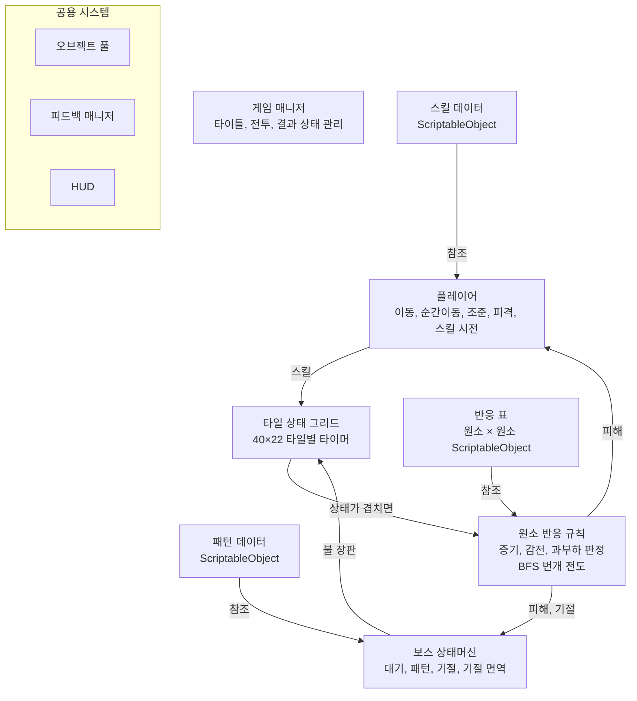
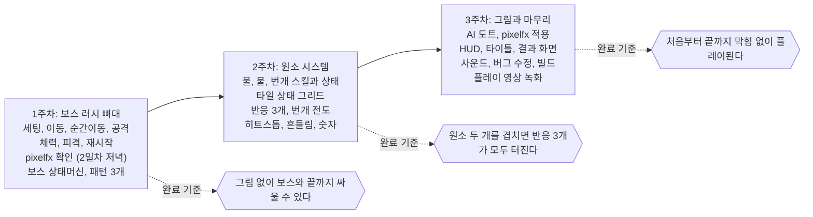

# Elemental Trials

## 개요

3주 동안 혼자 만드는 2D 도트 탑다운 보스 러시 액션이다. 원소 반응을 이용해 보스를 공략하는 것이 핵심이다.

| 항목 | 내용 |
| --- | --- |
| 가제 | 원소의 시련 (Elemental Trials) |
| 장르 | 2D 탑다운 보스 러시 액션 |
| 플랫폼 | PC (Windows) |
| 개발 인원 | 1인 (기획, 프로그래밍) |
| 개발 기간 | 3주 |
| 엔진 | Unity 2D (URP) |
| 조작 | 키보드 + 마우스 |
| 플레이 타임 | 1판 2\~3분, 전체 10\~15분 |
| 리소스 | 도트 그래픽은 AI 생성, 이펙트는 pixelfx(MIT), 코드는 직접 구현 |
| 목적 | 포트폴리오 (PC 게임사 클라이언트 프로그래머 지원) |

## 기획 의도와 핵심 재미

원소를 어디에, 어떤 순서로 섞을지 판단해서 보스를 무너뜨리는 재미를 만든다. 그 반응이 플레이어에게도 똑같이 위험하다는 점이 긴장을 만든다.

**핵심 재미 3가지**

- **조합**: 불, 물, 번개 중 두 원소를 겹치면 반응이 일어난다. 물로 적시고 번개를 떨어뜨리면 감전, 불과 번개를 겹치면 과부하 폭발, 불과 물을 겹치면 증기가 된다.
- **양날의 검**: 번개는 젖은 바닥 전체로 퍼지고, 과부하 폭발은 범위 안의 모두를 친다. 플레이어도 같이 맞기 때문에 반응을 터뜨리는 위치 판단이 실력이 된다.
- **환경 활용**: 보스가 깐 불 장판에 물을 뿌리면 증기가 생긴다. 증기 안에 있으면 보스가 나를 정확히 조준하지 못한다.

**디자인 원칙**

1. 모든 보스 공격에는 예고가 있다. 맞으면 내 잘못이라고 느껴야 한다.
2. 원소 반응은 보스와 플레이어에게 같은 규칙으로 적용된다.
3. 수치보다 손맛이 먼저다. 히트스톱, 흔들림, 숫자 팝업으로 반응의 결과를 눈과 귀로 확인시킨다.

## 핵심 게임 루프와 플레이 흐름

전투 한 사이클은 10\~15초이며, 보스가 쓰러질 때까지 반복된다.

**전투 루프**

1. 보스 패턴 예고를 보고 회피한다.
2. 물결로 보스와 바닥을 적신다.
3. 젖은 바닥에서 빠져나온다.
4. 번개를 떨어뜨려 감전시킨다.
5. 기절한 1.6초 동안 기본 공격과 불덩이로 딜을 넣는다.
6. 1번으로 돌아간다.

**게임 흐름**

1. 타이틀 (조작 안내)
2. 보스 1 전투
3. 보스 2 전투 (선택 범위)
4. 결과 화면 (클리어 시간, 남은 체력) 후 재시작

## 조작

| 입력 | 동작 |
| --- | --- |
| W A S D | 이동 |
| 마우스 | 조준 |
| 좌클릭 (누르고 있기) | 기본 공격 연사 |
| 1 | 불 스킬 (불덩이) |
| 2 | 물 스킬 (물결) |
| 3 | 번개 스킬 (번개) |
| 스페이스 | 순간이동 (이동 방향으로, 정지 중에는 불가, 짧은 무적) |
| Enter | 결과 화면에서 재시작 |

## 플레이어 스펙

수치는 웹 프로토타입 기준이며, Unity에서는 Pixels Per Unit 16으로 환산한다.

| 항목 | 값 | Unity 환산 |
| --- | --- | --- |
| 체력 | 6 (하트) | 6 |
| 이동 속도 | 72 px/초 | 4.5 유닛/초 |
| 순간이동 | 560 px/초로 0.06초 (약 34 px), 그동안 모습이 사라짐 | 35 유닛/초, 약 2.1 유닛 이동 |
| 순간이동 쿨다운 | 1초 | 1초 |
| 순간이동 무적 | 0.3초 | 0.3초 |
| 피격 후 무적 | 1초 (깜빡임) | 1초 |
| 피격 판정 크기 | 4 × 4 px (새 기준 8 × 8) | 0.25 유닛 |

## 원소 스킬 상세

스킬은 4개이며 모두 ScriptableObject 데이터로 관리해 수치 조정과 추가가 코드 수정 없이 되게 한다.

| 스킬 | 키 | 쿨다운 | 데미지 | 효과 |
| --- | --- | --- | --- | --- |
| 기본 공격 | 좌클릭 | 0.16초 | 1 | 직선 투사체, 230 px/초 |
| 불덩이 | 1 | 1.2초 | 폭발 8 | 마우스 위치에서 폭발, 반경 14 px 바닥에 불 3.5초, 보스에게 화상 |
| 물결 | 2 | 1.4초 | 2 | 전방 부채꼴 (각도 ±0.5 rad, 거리 56 px) 바닥 젖음 7초, 보스에게 젖음 |
| 번개 | 3 | 1.8초 | 10 | 0.3초 예고 후 마우스 위치에 낙뢰, 보스에게 대전, 젖은 바닥을 따라 전도 |

## 원소 상태

원소 공격에 맞으면 해당 상태가 붙는다. 상태는 보스와 플레이어 모두에게 같은 규칙으로 적용된다.

| 원소 | 상태 | 지속 | 효과 |
| --- | --- | --- | --- |
| 불 | 화상 | 3초 | 0.5초마다 2 데미지 |
| 물 | 젖음 | 5초 | 단독 효과 없음, 반응 재료 |
| 번개 | 대전 | 2초 | 맞는 순간 0.2초 경직 |

## 바닥 상태와 원소 반응 규칙

아레나는 8 px(새 기준 16 px) 타일 40 × 22칸이며, 타일마다 상태 타이머를 가진다. 아레나에는 영구 웅덩이 3곳이 고정 배치된다.

**바닥 상태**

바닥에는 젖음과 불만 남는다. 대전은 바닥에 남지 않는다.

| 상태 | 지속 | 효과 |
| --- | --- | --- |
| 젖음 | 7초 (웅덩이는 영구) | 번개 전도 경로가 된다. 위에 선 보스와 플레이어는 젖음 상태가 된다. |
| 불 | 3.5\~4초 | 위에 선 플레이어는 피격된다. 보스는 0.4초마다 2 데미지와 화상. |
| 증기 | 3초 | 안에 있는 플레이어를 보스가 정확히 조준하지 못한다 (최대 50 px 오차). |
| 전기 | 0.5초 | 낙뢰 순간 전도 범위 표시용. |
| 경고 | 0.9초 | 보스 불 장판 예고. 끝나면 불이 된다. |

**원소 반응**

순서는 상관없다. 화상 상태에 물을 맞혀도, 젖음 상태에 불을 맞혀도 같은 반응이 일어난다.

| 조합 | 반응 | 효과 | 역할 |
| --- | --- | --- | --- |
| 불 + 물 | 증기 | 보스는 3초간 공격이 빗나간다 (조준 오차). 바닥에서는 증기 구름 3초가 생긴다. | 방어 |
| 물 + 번개 | 감전 | 30 데미지 + 기절 1.6초. 젖은 바닥을 따라 최대 160칸까지 전도되며, 그 위의 플레이어도 피격된다. | 폭딜 |
| 번개 + 불 | 과부하 | 반경 20 px 폭발, 15 데미지 + 넉백. 범위 안의 플레이어도 피격된다. | 범위 딜 |

**반응 규칙**

1. **같은 원소 중첩**: 상태 시간만 갱신한다. (화상 + 불 = 화상 3초로 다시 시작)
2. **반응 후 상태 소모**: 반응이 일어나면 재료가 된 두 상태가 모두 사라진다.
3. **기절 면역**: 감전 기절이 끝나면 5초간 기절 면역이다. 면역 중 감전은 데미지만 들어간다.
4. **1단계 반응만**: 반응 결과(증기 등)는 다른 원소와 다시 반응하지 않는다. 2차 반응은 선택 범위다.
5. **바닥과 대상**: 바닥에는 젖음과 불만 남는다. 젖은 바닥이나 불 바닥에 선 대상은 그 상태를 얻는다.
6. **보스 원소 공격도 반응**: 보스의 불 장판도 플레이어의 물, 번개와 반응한다.
7. **반응 표 데이터화**: 반응은 원소 × 원소 표(ScriptableObject)로 관리한다. 4, 5번째 원소는 표에 줄을 추가해 확장한다.

## 보스 설계: 잿빛 수호자

체력 500의 돌 골렘으로, 필수 패턴 3개와 선택 패턴 2개를 가진다. 체력 50%에서 2페이즈로 넘어간다.

**기본 스탯**

| 항목 | 값 |
| --- | --- |
| 체력 | 500 |
| 이동 속도 | 20 px/초 (2페이즈 27 px/초) |
| 접촉 데미지 | 1 |
| 걸리는 상태 | 화상, 젖음, 대전, 기절 (기절 후 5초 면역) |
| 대기 중 행동 | 거리 80 px 이상이면 접근, 45 px 이하면 후퇴 |
| 패턴 선택 | 무작위, 같은 패턴 연속 금지 |

**패턴**

| 패턴 | 예고 | 내용 | 범위 |
| --- | --- | --- | --- |
| 원형 탄막 | 코어 발광 0.6초 | 16방향 탄, 70 px/초 (2페이즈 20방향 2겹) | 필수 |
| 돌진 | 빨간 예고선 0.7초 | 230 px/초로 150 px 돌진, 멈춘 자리에서 10방향 탄 (60 px/초) | 필수 |
| 불 장판 | 빨간 바닥 0.9초 | 플레이어 발밑 1곳 + 주변 (가로 ±55, 세로 ±45 px) 3곳 (2페이즈 6곳)에 반경 12 px 불 4초. 보스는 0.6초 멈춤 | 필수 |
| 부채꼴 연사 | 0.35초 멈춤 후 조준 | 5발 부채꼴 (전체 약 41도, 105 px/초) 0.32초 간격 3회 (2페이즈 4회) | 필수 |
| 나선 탄막 | 2페이즈 전용 | 2.2초 동안 양방향 나선 | 선택 |

**페이즈**

- 1페이즈 (체력 100\~51%): 패턴 간격 0.9초, 코어 주황색
- 2페이즈 (체력 50% 이하): 속도 1.35배, 패턴 간격 0.55초, 코어 빨간색, 전환 시 포효와 화면 흔들림

**보스 2 (선택 범위)**: 컨셉 미정. 1주차 일정이 지켜졌을 때만 기획한다.

## 전투 연출과 타격감

모든 연출은 코드로 구현하며, 강한 반응일수록 연출을 겹쳐서 크게 보이게 한다.

| 연출 | 발동 조건 | 수치 |
| --- | --- | --- |
| 히트스톱 | 감전, 과부하, 플레이어 피격 | 0.07\~0.1초 |
| 화면 흔들림 | 폭발, 과부하, 돌진 충돌, 감전, 피격, 페이즈 전환 | 강도 2\~7 |
| 데미지 숫자 | 보스 피격 | 도트 숫자, 0.8초간 위로 떠오름, 원소별 색 |
| 피격 플래시 | 보스 피격 | 흰색 0.08초 |
| 피격 화면 | 플레이어 피격 | 붉은 화면 0.35초 |
| 낙뢰 섬광 | 번개 | 화면 하얗게 0.12초 |
| 순간이동 사라짐·나타남 | 순간이동 | 출발·도착 지점 이펙트 (pixelfx) |
| 반응 팝업 | 감전, 증기, 과부하, 전도, 분노 | 화면 상단 문구 0.8초 |

## UI와 HUD

| 요소 | 위치 | 내용 |
| --- | --- | --- |
| 보스 체력바 | 상단 중앙 | 이름과 체력, 2페이즈에 색 변경, 현재 상태 아이콘 (화상, 젖음, 대전, 기절 면역) |
| 반응 팝업 | 상단 중앙, 체력바 아래 | 감전, 증기, 과부하 등 반응 이름 |
| 플레이어 체력 | 좌하단 | 하트 6개, 현재 상태 아이콘 |
| 스킬 슬롯 | 우하단 | 기본, 불, 물, 번개, 순간이동 5칸과 쿨다운 표시 |
| 타이틀 | 전체 화면 | 게임 이름, 조작 안내, 시작 |
| 결과 화면 | 전체 화면 | 클리어 여부, 시간, 남은 체력, 재시작 |

## 아트, 이펙트, 사운드 가이드

픽셀 기준은 Pixels Per Unit 32, Pixel Perfect Camera 640 × 360으로 고정하고, AI 도트와 pixelfx 이펙트를 하나의 팔레트로 통일한다.

> 2026-11-16 해상도 변경: 이 문서 본문의 px 수치는 옛 기준(PPU 16, 1 px = 1/16 유닛)이다. 게임 수치는 유닛 값이 기준이고, 새 기준 px는 옛 값의 2배다. 그림 크기는 `Docs/art-asset-spec.md`를 따른다.

**AI 생성 도트 (정지 이미지 위주)**

- 플레이어: 대기, 걷기 2프레임
- 보스: 대기, 돌진, 기절
- 바닥, 벽, 웅덩이 타일
- UI 아이콘: 스킬 4개, 하트, 상태 4개 (화상, 젖음, 대전, 기절 면역)

**이펙트 담당 구분**

| 이펙트 | 담당 |
| --- | --- |
| 불덩이 폭발 | pixelfx 스프라이트 시트 |
| 낙뢰 | pixelfx 스프라이트 시트 |
| 물결 튀김 | pixelfx 스프라이트 시트 |
| 순간이동 사라짐·나타남 | pixelfx 스프라이트 시트 (arcane/blink-out, blink-in) |
| 증기 퍼프 | pixelfx 스프라이트 시트 |
| 감전 스파크 | pixelfx 스프라이트 시트 |
| 과부하 폭발 | pixelfx 스프라이트 시트 |
| 번개 전도 경로 | 직접 구현 (경로가 매번 다름) |
| 바닥 상태 표시 | 직접 구현 (타일맵 오버레이) |
| 히트 플래시, 흔들림, 데미지 숫자 | 직접 구현 |

**규칙**

- pixelfx는 고정 버전으로 받는다.
- MIT 크레딧은 서드파티 고지 파일에 넣고, Patch Pixel 폰트는 사용하지 않는다.
- 효과음은 무료 에셋 또는 AI 생성, BGM은 1곡.

## 기술 구조

스킬과 보스는 서로를 직접 건드리지 않고, 타일 상태 그리드를 거쳐 원소 반응 규칙이 피해를 계산한다. 반응 내용은 반응 표 데이터에서 읽는다.

이 구조 덕분에 원소나 반응을 추가해도 반응 표에 줄만 추가하면 된다.

## 개발 범위

필수 범위만으로 완성된 게임이 되어야 하며, 선택 범위는 필수가 끝난 뒤에만 손댄다.

**필수**

- [ ] 플레이어 이동, 순간이동, 조준, 기본 공격
- [ ] 체력, 피격 무적, 사망, 재시작
- [ ] 보스 1명, 상태머신, 패턴 4개 (원형 탄막, 부채꼴 연사, 돌진, 불 장판)
- [ ] 원소 스킬 3개 (불, 물, 번개)와 원소 상태 3개 (화상, 젖음, 대전)
- [ ] 바닥 상태 (젖음, 불) + 반응 3개 (증기, 감전, 과부하) + 번개 전도
- [ ] 반응 규칙 (상태 시간 갱신, 상태 소모, 기절 면역)
- [ ] 히트스톱, 화면 흔들림, 데미지 숫자
- [ ] HUD, 타이틀, 결과 화면
- [ ] AI 도트와 pixelfx 이펙트 적용

**선택 (순서대로)**

- [ ] 2페이즈
- [ ] 선택 패턴 1개 (나선 탄막)
- [ ] 보스 2
- [ ] 4번째 원소 (흙 후보: 진흙, 용암 반응)
- [ ] 2차 반응 (반응 결과 + 원소)
- [ ] 5번째 원소

**제외**

- 일반 몬스터, 맵 탐험, 스킬 장착 선택, 성장 요소, 세이브, 멀티플레이

## 일정과 완료 기준

매주 그 자체로 플레이 가능한 상태로 끝내며, 아래 마름모는 그 주의 완료 기준이다.

1주차가 밀리면 보스 2부터 포기하고, 3주차 전까지 도트와 이펙트는 색깔 도형으로 임시 처리한다.

## 리스크와 대응

| 리스크 | 위험 신호 | 대응 |
| --- | --- | --- |
| 바닥 상태 시스템이 막힘 | 4일 차 지나도 젖음 표시가 안 됨 | 타일맵 대신 타일마다 스프라이트 오브젝트로 단순화 |
| 번개 전도(BFS) 이해 부족 | 하루 넘게 전도가 안 퍼짐 | 전도를 고정 반경 원형 범위로 대체, 이후 개선 |
| 반응 3개가 2주차에 다 안 끝남 | 2주차 4일 차에 감전만 동작 | 감전 우선 완성, 과부하는 범위 데미지만, 증기는 3주차로 이동 |
| 반응 밸런스 쏠림 | 테스트에서 감전만 쓰게 됨 | 반응 표 데이터에서 수치만 조정 |
| 보스 패턴 구조가 엉킴 | 패턴 추가할 때마다 기존 패턴이 깨짐 | 패턴을 상태 클래스로 분리하는 구조로 1회 리팩터링 |
| pixelfx를 Unity로 못 가져옴 | 2일 차 저녁 확인에서 실패 | 이펙트는 Unity 파티클로 대체 |
| AI 도트 스타일 불일치 | 캐릭터와 이펙트가 따로 노는 느낌 | 팔레트 하나로 양자화, 픽셀 크기 통일 |
| 이펙트 다듬기에 시간 과다 사용 | 3주차 전에 이펙트 작업 시작 | 3주차 전까지 색깔 도형으로 임시 처리 |
| 히트스톱이 UI까지 멈춤 | Time.timeScale 사용 후 UI 정지 | UI와 사운드는 unscaled time 사용 |

## 포트폴리오 어필 포인트

코드는 전부 직접 구현하며, 아래 항목을 트러블슈팅 기록과 함께 정리한다.

- 보스 AI 상태머신과 패턴 구조 설계
- 타일 단위 상태 시스템과 원소 반응 규칙
- 원소 × 원소 반응 표 데이터 설계 (원소 추가 시 코드 수정 없음)
- BFS 기반 번개 전도
- ScriptableObject 기반 데이터 설계 (스킬, 패턴, 반응 수치)
- 오브젝트 풀링으로 탄막 처리
- 히트스톱, 화면 흔들림 등 타격감 구현
- pixelfx 이펙트를 스프라이트 시트로 변환해 Unity로 가져오는 파이프라인 구축
- 플레이 영상 1\~2분, 핵심 코드 설명 문서
